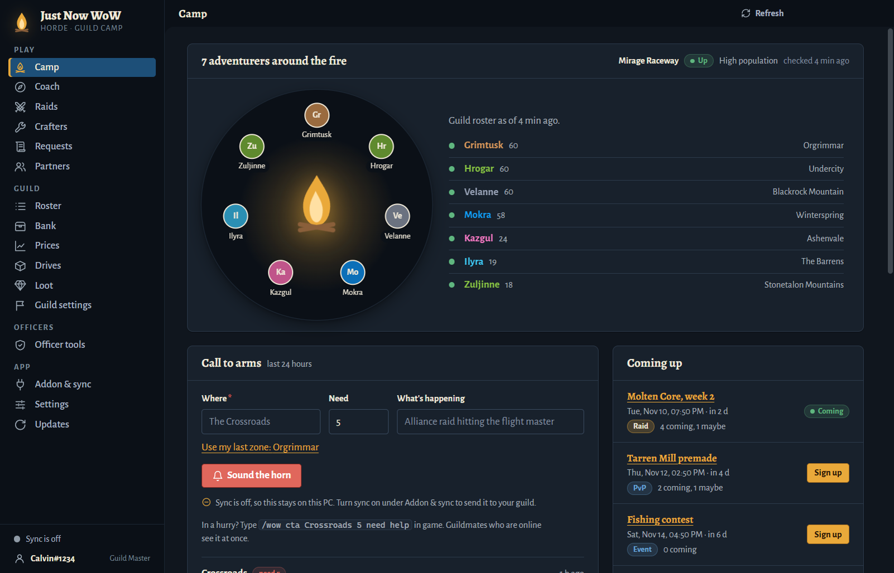
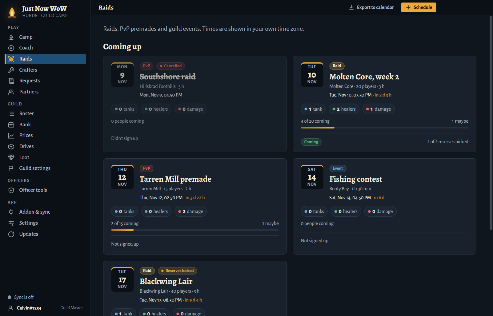
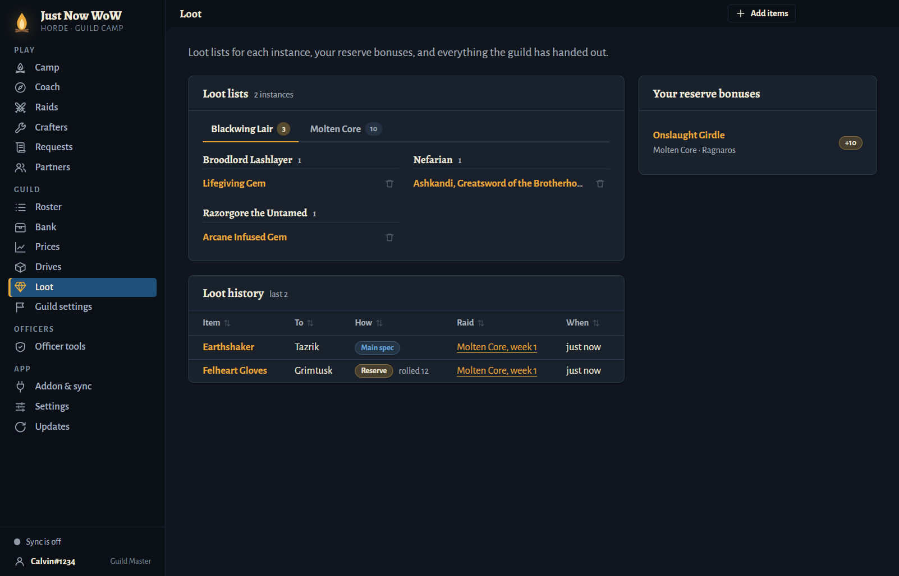
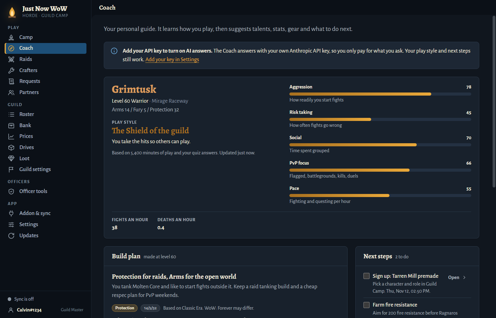
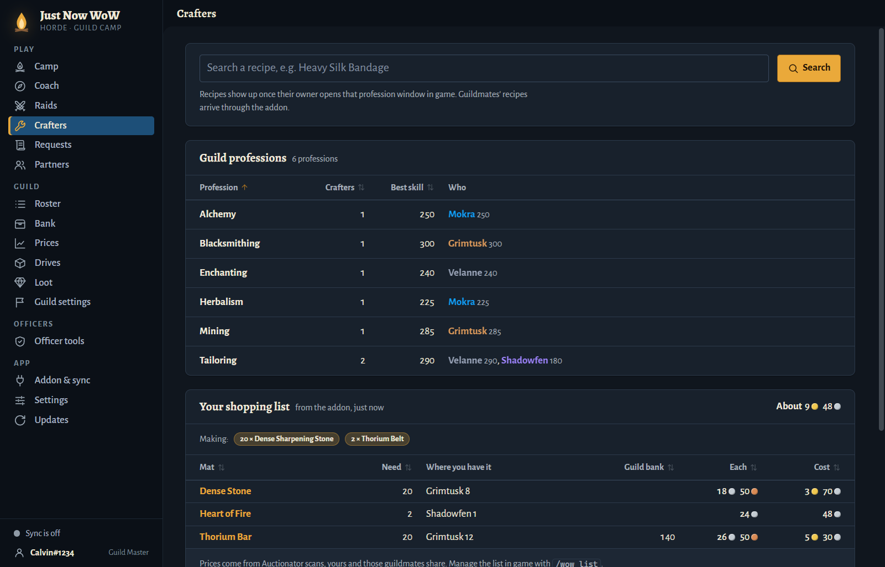
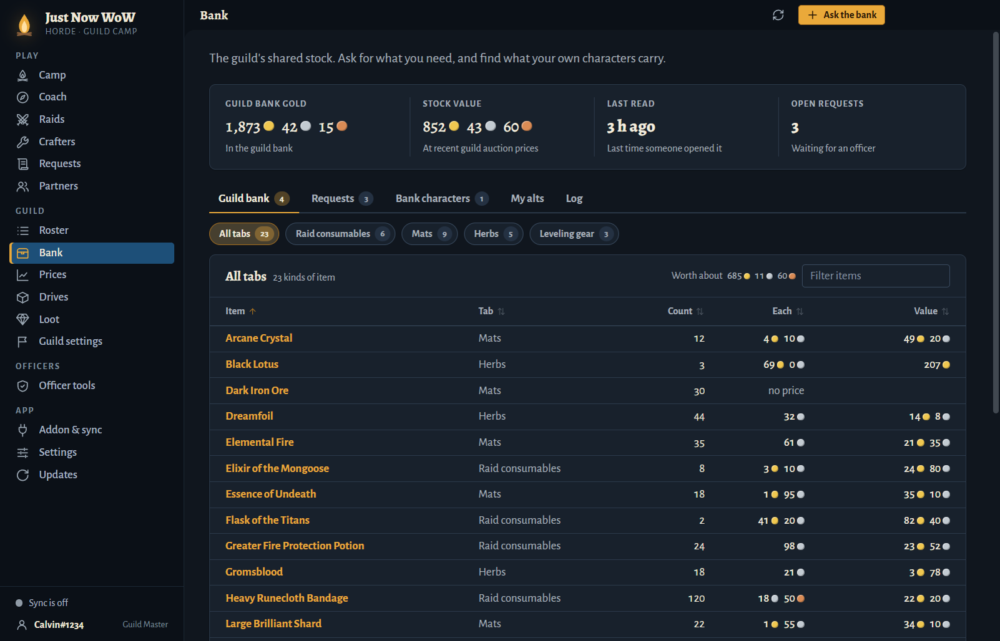
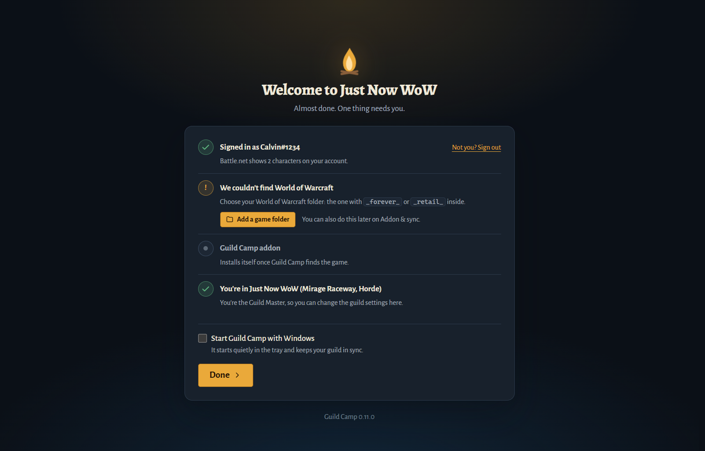
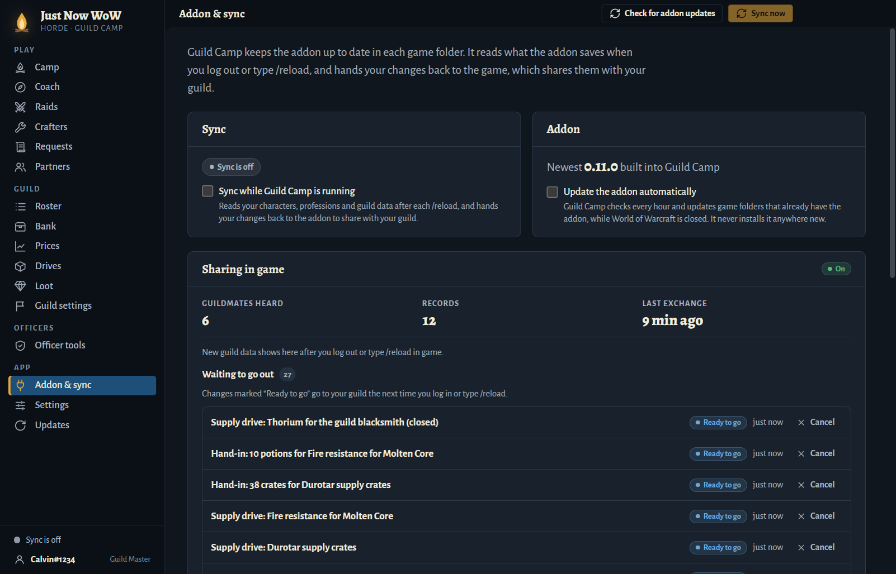

<p align="center">
  
</p>

<h1 align="center">Guild Camp</h1>

<p align="center">
  <b>Your guild's campfire for World of Warcraft: Forever.</b><br>
  Raids, soft reserves, crafters, the guild bank and a personal coach, in a desktop app and an in-game addon.
</p>

<p align="center">
  <a href="https://github.com/arrow-quiver/wow/releases/latest"></a>
  
  
  
</p>

<p align="center">
  
</p>

---

## Why Guild Camp?

- **No website, no server, no subscription.** Every player runs the app on their own PC. Guild data travels
  between guildmates inside the game, through the addon.
- **One place for the whole guild.** Sign-ups, soft reserves, loot, crafters, bank requests and supply drives,
  instead of a dozen Discord channels and spreadsheets.
- **Works while you play.** The addon brings guild news, raid reminders and smarter tooltips into the game.
- **Installs and updates itself.** The app finds your game folders, installs the addon and keeps both up to date.

## Features

### 🔥 Camp

See who's online around the fire, where they are and what level they've reached. Sound a **call to arms** when
the Alliance hits the Crossroads, read guild notices and see what's coming up next.

### ⚔️ Raids, soft reserves and loot



- Schedule raids, PvP premades and guild events. Times show in each player's own time zone, and you can export
  them to your calendar.
- Sign up with a character and role, and see tanks, healers and damage at a glance.
- **Soft reserves with an SR+ loyalty bonus** for players who keep reserving the same item.
- Officers get a loot screen for handing out items; everyone sees the loot lists and the full loot history.



### 🧭 Coach



The Coach learns how you play from a short quiz and from what you do in game, then scores your play style
(aggression, risk taking, social, PvP focus and pace). It suggests a build plan and a list of next steps: unspent
talent points, repairs, bag space, trainer visits, raid sign-ups and more. Ask it questions with your own
Anthropic API key; everything else works without one. Follow-up questions remember the last few answers.

In game, the Coach sits **beside your talent window**: the next talent your plan wants (with a glow on it), and the
plan's order with what you've taken ticked off. **Item tooltips** say whether an item is an upgrade for your build,
weighed by your plan's stat priorities against what you're wearing.

**Coach overlay and live link.** Press **Ctrl+Shift+G** while you play and a small Coach window shows on top of the
game (use Windowed (Fullscreen) mode): this session's kills and deaths, what to do next and a quick Ask box. After a
death, **Why did I die?** sends the death's recap (who hit you, with what, how much healing you got) to the Coach.
The live link reads the game's own combat log file as you play, like Warcraft Logs' uploader does; type `/wow live on`
once and the addon turns combat logging on at every login. Answers reach the game's Coach after your next /reload.

**Guild seasons.** Every month the guild starts a new leaderboard from what people actually do: gold and items given
to the guild bank (valued at that day's Auctionator price), kills in the open world, crafting requests filled and raids.
Leaders get titles (Quartermaster, Warlord, Master Crafter, Stalwart, MVP), weeks in a row build a streak bonus,
lifetime badges show on your tooltip in game, and officers announce the winners to Discord when the month ends.
Gifts and new badges get an automatic thank-you on Discord. See the **Seasons** page or type `/wow season`.
Points buy things in the **guild bank store**: officers put items up for points, guildies order, officers mail them.

**War alerts and the war map.** Die to players and the app posts it to the guild's Discord at once ("⚔️ Grom died to
Sneaky and 2 more in Hillsbrad Foothills. Anyone near?"), so whoever's close can come and help. In game, a popup
after a death in a PvP area calls the guild to arms in one click; the overlay and the **War** page have a
**Call for help** button for Discord. Every death and honorable kill in the open world goes on the guild's war map:
pins on the in-game world map, and the **War** page with hotspots and your nemeses (the players who keep killing you).

### 🛠️ Crafters, requests and partners



- Search any recipe and find who in the guild can make it.
- Post **crafting requests** and find **leveling partners**.
- Your in-game shopping list shows up here too, with what your alts already carry, what the guild bank holds and
  what it will cost.

### 🏦 Bank, prices and drives



- Browse the guild bank by tab, valued at guild auction prices, and see what your own alts carry.
- **Ask the bank** for items; officers handle requests in one place.
- **Guild prices** come from the Auctionator scans guildmates share.
- **Deal hunter**: finds items listed well under their usual price in your own Auctionator scans, with the profit
  after the auction house cut, how sure it is, vendor flips, and what to buy with a budget. In game it sits beside
  the auction house and searches each deal with one click.
- **Guild Camp at the auction house**: one list of what to buy, your shopping list's missing mats and what guildies
  asked the guild bank for (to donate), each with its price and the total. **Buy selected…** asks once with the
  total, then the button buys one thing per click (the game needs a click for every purchase). It skips anything over
  20% above its expected price and never spends past the total you agreed to. **Stop** ends it at once.
- Run **supply drives** (fire resistance potions for Molten Core, thorium for the guild blacksmith) and track
  every hand-in.

### 🎮 In the game

The addon works on its own, and does much more with the app:

- **Skill-up guide**: ranks the recipes you know by cost per skill point, so you level professions cheaply.
- **Shopping list**: works out the materials you still need and ticks them off as you loot. With Auctionator it
  can search the auction house for you.
- **Item tooltips**: who in the guild can craft it, how many your alts hold and what's in the guild bank.
- **Guild news**: notices, raid reminders, crafting requests and calls to arms, right in game.
- A minimap button (or a Titan Panel / ElvUI broker), the Retail addon drawer and key bindings.

| Command | What it does |
| --- | --- |
| `/wow` or `/guildcamp` | Open the Guild Camp window |
| `/wow coach` | Open the Coach |
| `/wow season` | This month's guild season: the top five and your place |
| `/wow war` | Your war map marks; `/wow war off` hides the guild's deaths and kills on the world map |
| `/wow live on` | Turn on combat logging at every login, for the app's live link and Coach overlay (`/wow live off` stops it) |
| `/wow guide` | Open the skill-up guide |
| `/wow list` | Open the shopping list |
| `/wow deals` | Open the Deal hunter (it also opens with the auction house) |
| `/wow cta <where> <need> <what>` | Sound a call to arms, e.g. `/wow cta Crossroads 5 need help` |
| `/wow status` | Show what's been saved and when guild news last arrived |
| `/wow options` | Open the settings |

Everything runs outside combat and only reads what the game shows freely.

## Install

1. Download **`Guild-Camp-Setup-<version>.exe`** from the
   [latest release](https://github.com/arrow-quiver/wow/releases/latest) and run it. The installer isn't
   code-signed yet, so Windows SmartScreen asks once: **More info → Run anyway**.
2. Open Guild Camp. Sign in with Battle.net, or continue without it. Guild Camp finds your game folders and
   installs the addon. If your game is somewhere unusual, pick the folder with `_forever_` or `_retail_` inside.
3. Log in to the game on a character in your guild, then log out or type `/reload`. Guild Camp picks up your
   guild from there.



The app updates itself and the addon from GitHub. It starts with Windows and stays in the tray, so your guild
stays in sync. You can turn that off in Settings.

## How it works




1. The addon saves what the game shows. WoW writes it to disk when you log out or type `/reload`.
2. The app reads that file and shows it. Changes you make in the app (a sign-up, a request) go to the addon,
   which sends them to your guild the next time you log in or type `/reload`.
3. Guildmates who are online pass guild data on to each other, so it reaches you even when the person who made
   it has logged off. New guild data shows in the app after you log out or type `/reload` in game.
4. Your role comes from your in-game rank. The Guild Master decides which ranks count as officers.

## FAQ

**Does the whole guild need the app?**
No. The more guildmates run it, the faster data spreads, but the addon passes guild data along in game on its
own. Players without the app still get the skill-up guide, shopping list and Coach.

**Does it touch the game?**
No. The addon uses the normal addon API, runs outside combat and reads only what the game shows you. The app
only reads and writes the addon's saved files.

**Where does my data go?**
It stays on your PC and in your guild. There is no Guild Camp server. The Coach's AI answers go to Anthropic
only if you add your own API key.

**Why don't I see new guild data?**
WoW writes addon data to disk only when you log out or type `/reload`. Do one of those, and check that sync is
on under **Addon & sync**.

**Do I need CurseForge?**
No. The app installs and updates the addon for you.

---

## For developers

You need Node.js 24 (the tests use its built-in `node:sqlite`, as the app does inside Electron) and Git.
Windows is the main target.

```bash
npm install                    # at the repo root; also installs app/
GUILDCAMP_NO_SCAN=1 npm test   # every test: node --test "app/test/**/*.test.{js,mjs}"
```

Run the app from `app/`, always with a scratch profile and without scanning your real game folders:

```bash
cd app
GUILDCAMP_NO_SCAN=1 npx electron . --user-data ./dist/dev-profile
```

Without those two settings a dev app finds your real World of Warcraft folders and installs, updates or syncs
the addon there, exactly like the installed app does. To try it with game data, add a fake game folder under
Addon & sync in the scratch profile.

Screenshots of every page with a demo guild (safe by default; nothing touches your game or settings):

```bash
cd app
npx electron . --smoke --smoke-seed      # pictures and a report in app/dist/smoke
```

Heavy simulations of many players run only with `GUILDCAMP_SIM_HEAVY=1`. Tests never touch the network, a real
game folder or the real GitHub CLI.

Read these next:

- [docs/CONTRIBUTING.md](docs/CONTRIBUTING.md): `main` is the trunk; every change goes to it through a pull request.
- [docs/ARCHITECTURE.md](docs/ARCHITECTURE.md): how the app, its local core, the addon and GitHub fit together,
  the safety rules for development, and the test layout.
- [docs/SHARING.md](docs/SHARING.md): how the addon shares guild data in game.
- [docs/api/](docs/api/): every endpoint of the app's local core.

## Releasing

App and addon releases are GitHub releases on this repository, published with the GitHub CLI (`gh`):

```bash
node scripts/release.js addon --bump patch --notes "What changed"
node scripts/release.js app --bump minor --notes-from-git
```

Add `--dry-run` to build and zip without publishing. Pushing a `v<version>` or `addon-v<version>` tag publishes
from GitHub Actions instead, and the app's **Releases** page can publish from a PC that has the source code and
`gh` signed in. First-time setup (making the repository public, `gh auth login`, the Battle.net client id and
secret that are built into the installer) and every step are in [docs/RELEASING.md](docs/RELEASING.md).
